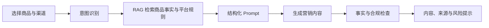

# 农品智营：AI 农产品营销与合规助手

面向农产品运营人员的 AI 内容工作台。系统基于商品事实和平台规则，生成卖点、短视频脚本、直播话术与售前问答，并在发布前执行表达风险检查。

> 这是一项独立产品案例，基于农业营销实习中的匿名化观察设计。页面中的商品、价格和品牌均为虚构示例，不表示企业实际上线成果。

## 在线体验

[打开交互式 Demo](https://josieiswjx.github.io/agri-ai-marketing-case/)

## 问题

小型农产品商家的营销信息通常分散在包装、商品详情、线下知识和运营人员经验中。直接使用通用大模型容易产生四类问题：

1. 编造产地、规格、库存或价格。
2. 使用医疗功效、绝对化用语等高风险表达。
3. 不同渠道复用同一套文案，缺少场景差异。
4. 生成结果没有来源，人工复核成本高。

## 产品方案



核心任务：

- 卖点提炼
- 短视频脚本
- 直播话术
- 售前问答
- 合规检查

## 知识库设计

### 商品事实层

字段包括：商品名称、品类、产地、配料、规格、口感或使用方式、物流、售后和可公开证明。

### 营销规则层

- 禁止医疗功效和无依据的健康承诺。
- 谨慎处理“最好”“第一”“100%”等绝对化表达。
- 价格、规格、库存、发货时间和认证必须有实时证据。
- 当信息不足时，返回“待人工确认”，不生成推测答案。

### 渠道模板层

- 短视频：Hook → 场景 → 证据 → CTA
- 直播：开场 → 展示 → 答疑 → 行动
- 图文：标题 → 使用场景 → 商品事实 → 购买提示
- 问答：问题 → 证据答案 → 缺失信息兜底

## 数据结构示例

```json
{
  "product_id": "honey-demo-01",
  "name": "云岭百花蜜",
  "category": "食品 / 蜂蜜",
  "origin": "云南高山蜜源区域",
  "ingredients": ["百花蜂蜜"],
  "spec": "500g",
  "claims": [
    {
      "text": "口感清甜，花香较明显",
      "source": "商品资料 P3",
      "verified": true
    }
  ],
  "risk_rules": ["medical_claim", "absolute_claim", "unverified_price"]
}
```

## 评测方案

当前交互 Demo 提供规则版基线测试，验证：

- 3 个商品 × 4 类内容任务的输出结构。
- 回答是否附有商品事实来源。
- 是否拦截医疗功效与绝对化表述。
- 缺少信息时是否降级到人工确认。

正式接入大模型后，应补充：

- 20—30 条固定测试集。
- 事实一致率、任务完成率、合规通过率。
- 人工一次通过率和平均修改时间。
- Prompt 与模型版本的 A/B 对比。

## 产品边界

- 当前页面使用本地预置数据和确定性规则，不调用真实 LLM。
- 不自动发布内容，不替代运营人员的事实审核。
- 不在浏览器中保存 API Key。
- 不应上传未获授权的企业数据或用户个人信息。

## 下一步

1. 接入 OpenAI 兼容模型与向量数据库，替换本地规则生成器。
2. 建立 30 条人工标注测试集和 Badcase 分类体系。
3. 增加商品资料上传、字段抽取与人工确认。
4. 招募 3—5 名农产品运营人员完成可用性测试。
5. 验证生成时间、一次通过率和人工修改率。
